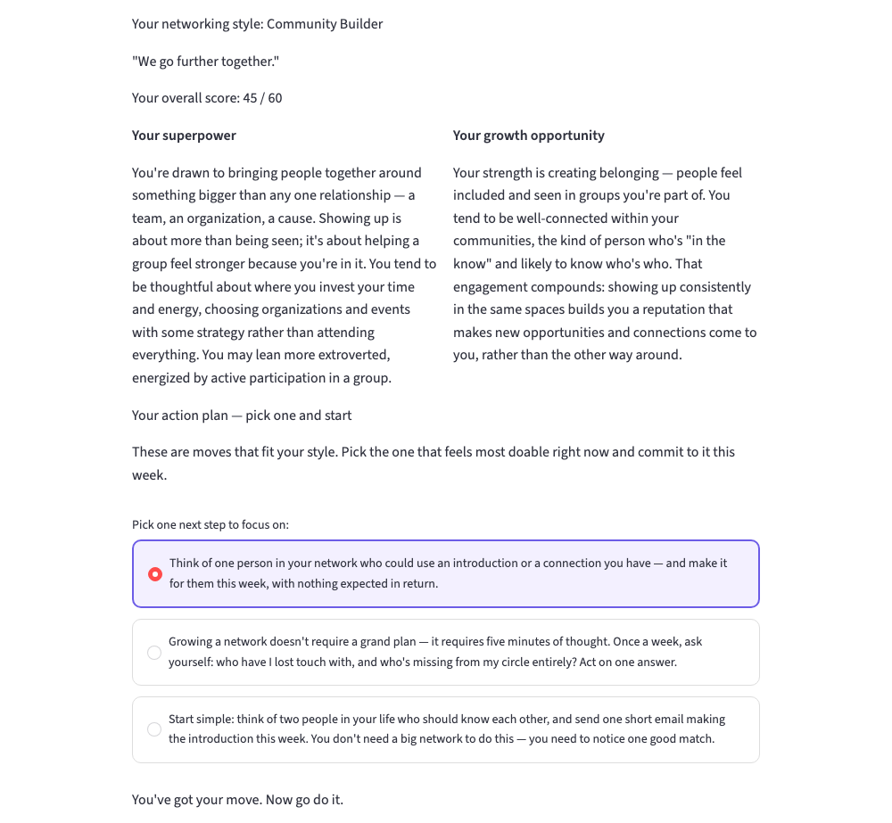

# Werk It Girls Networking Assessment — RAG Backend

A tool that reads answers to a 15-question networking quiz and writes
a personalized result in the Werk It Girls voice, grounded in a curated set
of coaching content — instead of matching to one of a handful of fixed
paragraphs.

## What it does

You answer 15 questions about how you network today. Instead of getting a
generic paragraph based on which bucket you land in, this app looks up the
coaching material that best matches your specific answers and writes a result
built for you. It's the engine behind the existing quiz at
tools.werkitgirls.com — this repo is the new part that writes the personalized
response; the quiz itself lives elsewhere and doesn't change.

## Screenshot



---

## Setup

**Everything a stranger needs, in order.** Test this by handing it to someone
and watching them. Every question they ask is a bug in this section.

### You will need

- Python 3.11 or newer
- A free GitHub account, to clone this repo
- An internet connection the first time you run it (it downloads a small file to build its
  search index)

### Steps

```bash
# 1. Get the code
git clone https://github.com/smmickelson/Rag-Knowlegde-Assistant.git
cd Rag-Knowlegde-Assistant

# 2. Install what it needs
python3 -m venv .venv && source .venv/bin/activate   # Windows: .venv\Scripts\activate
pip install -r requirements.txt

# 3. Run it
streamlit run app.py
```

Your browser should open automatically to http://localhost:8501. If it doesn't, open that
address yourself.

### What you should see

- Before the quiz starts, a short paragraph explaining the philosophy behind the assessment.
- A page titled "What Kind of Networker Are You?" with 15 questions, each with four answer
  choices (Never, Occasionally, Frequently, Always).
- The Submit button stays greyed out until every question has an answer.
- After submitting, a results screen showing your networking style with a one-line tagline,
  your overall score out of 60, your "superpower" and "growth opportunity" side by side, and
  a personalized action plan with three next-step options to choose from.
- A status line beneath the options that confirms once you've picked one.
- A Retake button that clears everything and lets you start over.

### Try it yourself

This is the task list used for alpha testing — a good way to try the app the way a
real user would, rather than just clicking around.

**You are:** someone who is looking for a job, wishing to change positions, or simply
wanting to explore new opportunities. You want to review how well you maintain and
grow your personal connections to find gaps and authentic ways to improve and grow
those relationships -- where you can ask for help, open doors for each other, and
give and receive honest feedback.

**Try to:**
1. Take the quiz to find out your networking style.
2. Commit to one action from your results.
3. Take the quiz again, with different answers this time.

### If something doesn't work

- **"command not found: python3"** — try `python` instead of `python3`.
- **Nothing seems different after activating the virtual environment** — check that your
  terminal prompt now starts with `(.venv)`. If it doesn't, the activate command didn't run;
  try it again exactly as written above.
- **`pip install` fails or hangs** — check your Python version with `python3 --version`; it
  needs to be 3.11 or newer.
- **The browser says the page can't be reached** — check your terminal for an error message
  right after running `streamlit run app.py`; it usually explains what went wrong.
- **"Address already in use"** — you likely have another Streamlit app running already; close
  that terminal/tab first, or press Ctrl+C in it, then try again.
- **Your results screen says "We couldn't load your personalized suggestions right now"** —
  the first time the app runs, it needs to download a small file to build its search index.
  If your network blocks that (common on some school or shared wifi), this message shows up
  instead of a crash. Try a different network (a phone hotspot works) and retake the quiz.

### Running the tests

```bash
pytest
```

Every test should pass. If one fails, that is the app telling you something is
broken. Read what it says before changing anything.

---

## Project status

**Current version:** alpha
**Working:** The full quiz flow -- answer all 15 questions, see your networking style, score,
identity/strengths, and a personalized action plan built from retrieved coaching content.
**Not working yet:** see [docs/backlog.md](docs/backlog.md) for what's planned next.

## How this project is organized

| Where | What's in it |
|---|---|
| [`docs/proposal.md`](docs/proposal.md) | The problem this solves and who it's for |
| [`docs/backlog.md`](docs/backlog.md) | Every feature, in build order, with its acceptance criteria |
| [`specs/`](specs/) | One page per feature: what it does, what it doesn't, what "done" means |
| [`AGENTS.md`](AGENTS.md) | The rules every AI assistant must follow in this repo |
| `src/` | The code |
| `tests/` | The automatic tests |
| [`CHANGELOG.md`](CHANGELOG.md) | What changed between versions |

## License

MIT. See [LICENSE](LICENSE).
